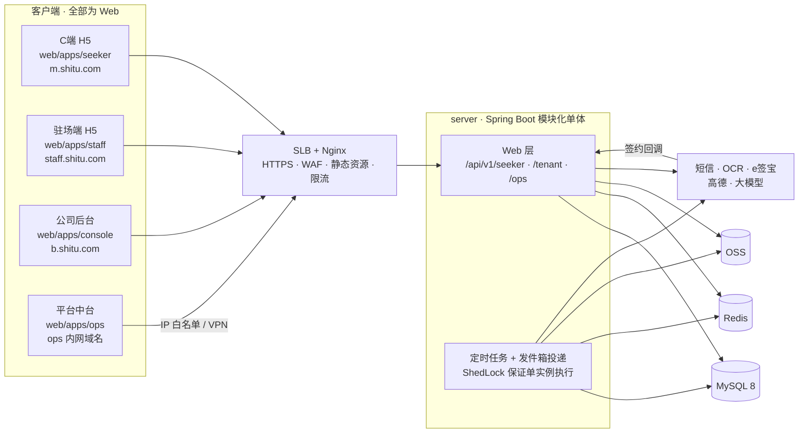

# 02 · 系统架构设计

> 已定：后端 **Java**；C 端与驻场端为 **H5**（不做小程序）。其余选型见 [04-决策记录](04-决策记录.md)。

## 1. 架构原则

1. **模块化单体，不做微服务**。V1.0 的团队规模和用户量级都撑不起微服务的运维成本。后端是一个可部署单元，内部按领域拆成 Maven 模块，模块之间只通过 Service 接口和领域事件交互，用 ArchUnit 在 CI 里强制检查依赖方向，以后需要时可以按模块拆出去。
2. **状态机是系统的心脏**。`user_status` / `bound_company_id` 只能通过 `LifecycleService.transition()` 修改，修改、写日志、发事件放在同一个事务里。
3. **规则配置化、版本化**。题库、引擎参数、计费规则、通知模板都存数据库，带版本号和生效时间；计费按发生当时的规则版本计算，可以追溯。
4. **定时任务全部幂等**。每个任务都有幂等键，重跑不会重复产生数据。
5. **AI 问薪匹配是确定性的规则引擎，不是大模型**。大模型只负责生成文字（推荐理由、经纪人分析报告、知识库问答），而且都有模板兜底，大模型挂了不影响主流程。
6. **业务规则只在后端写一份**。枚举、状态机、计费公式只在 Java 里实现；前端不自己判断公私域和匹配范围，直接使用接口返回的 `domainTag` / `matchScope` / `allowedActions`，枚举字典和 TS 类型都从 OpenAPI 自动生成。

## 2. 技术选型

| 层 | 选型 | 说明 |
|---|---|---|
| 语言 / 框架 | **Java 17 LTS + Spring Boot 3.4** | 与本机及团队现有 JDK 一致 |
| 持久层 | **MyBatis-Plus 3.5** + **Flyway** 管理数据库迁移 | 多租户插件 `TenantLineInnerInterceptor`；乐观锁插件；加密字段用自定义 `TypeHandler` |
| 数据库 | **MySQL 8.0**（阿里云 RDS MySQL） | 生成列 + 唯一索引（替代部分唯一索引）、触发器、JSON（答题和画像）、`SKIP LOCKED`、ngram 全文索引（知识库检索） |
| 缓存 / 锁 | **Redis 7 + Redisson** | 验证码、接口限流、分布式锁、热点缓存 |
| 定时任务 | Spring `@Scheduled` + **ShedLock**（锁存在 PG） | 多实例部署时每个任务只会在一个实例上执行；不额外引入 XXL-Job |
| 24h 超时 | **数据库扫描**：`response_window.deadline` 建索引，每分钟扫描一次 | 不依赖 Redis 延迟队列，重启不丢任务；最大延迟 1 分钟，对 24h 窗口可以接受 |
| 事件 | Spring `ApplicationEvent` + **事务发件箱** `outbox_event`，由轮询任务投递 | V1.0 不引入 MQ；以后要上 RocketMQ 只需替换投递器 |
| 安全 | Spring Security + JWT（access 15 分钟 / refresh 30 天） | 三套账号域：seeker / tenant / ops |
| 接口文档 | springdoc-openapi → 前端用 **orval** 生成 TS 客户端和类型 | |
| 工具 | MapStruct、FastExcel（花名册 / 工资表导入）、Hibernate Validator | |
| 测试 | JUnit 5、Testcontainers（真实 MySQL / Redis，需 Docker；本机无 Docker 时连本地 MySQL 测试库）、ArchUnit、REST Assured | |
| **C 端 H5** | **Vue 3 + Vite + TS + Vant 4** | 移动端组件库；适配微信内置浏览器和系统浏览器 |
| **驻场端 H5** | 同上，独立应用 | 驻场在厂区用手机操作 |
| 公司后台 / 平台中台 | **Vue 3 + Vite + TS + Element Plus + ECharts** | 用原型设计 Token 统一主题 |
| 前端工程 | pnpm workspace；Pinia；Vue Router；Vitest；Playwright（含移动端视口模拟） | |
| 第三方 | 短信（阿里云）、OCR 与二要素核验（阿里云）、电子签（**e签宝**）、地图（高德 JS API + 导航 URI）、大模型（国内已备案模型，适配器可替换） | 全部封装在 `integration` 模块里，每个都有 Mock 实现，开发和测试不依赖外部服务 |
| 部署 | Docker；阿里云 ECS（V1.0 规模不需要 K8s）+ SLB + RDS + Redis + OSS；Nginx 托管前端静态资源；SLS 日志 | |

## 3. 系统总体结构



- V1.0 先部署 2 个相同实例（Web 层和定时任务在同一个进程里，由 ShedLock 防止任务重复执行）。负载上来以后，可以用 profile 拆成「只跑 Web」和「只跑任务」两种实例。
- 平台中台走独立域名，加 IP 白名单或 VPN，账号体系和租户账号完全分开。

## 4. 仓库结构

```
shitu/
├─ server/                         # Maven 多模块
│  ├─ pom.xml                      # 父 POM，统一依赖版本
│  ├─ shitu-common/                # 枚举、错误码、通用 DTO、工具类、Clock 抽象
│  ├─ shitu-framework/             # 安全、租户上下文、数据权限、字段加密与脱敏、审计、幂等、全局异常、发件箱
│  ├─ shitu-integration/           # sms / ocr / esign / map / llm 适配器及 Mock
│  ├─ shitu-module-identity/
│  ├─ shitu-module-tenant/
│  ├─ shitu-module-job/
│  ├─ shitu-module-matching/       ★
│  ├─ shitu-module-lifecycle/      ★  状态机、24h 窗口、释放；包含 seeker / application / employment 子包
│  ├─ shitu-module-circulation/
│  ├─ shitu-module-billing/        ★
│  ├─ shitu-module-advance/        # 含精简版工资
│  ├─ shitu-module-risk/
│  ├─ shitu-module-notify/
│  ├─ shitu-module-report/
│  ├─ shitu-module-platform/       # 平台账号、审计查询、节假日、系统参数、知识库
│  └─ shitu-app/                   # Spring Boot 启动模块、Controller 聚合、Flyway 脚本、种子数据
├─ web/                            # pnpm workspace
│  ├─ apps/seeker/                 # C 端 H5（Vant）
│  ├─ apps/staff/                  # 驻场端 H5（Vant）
│  ├─ apps/console/                # 公司后台（Element Plus）
│  ├─ apps/ops/                    # 平台中台（Element Plus）
│  ├─ packages/api-client/         # orval 从 OpenAPI 生成的请求函数和类型
│  ├─ packages/ui-tokens/          # 原型 core.css → CSS 变量 + Vant / Element Plus 主题
│  └─ packages/ui-mobile/          # H5 公共组件：状态标签、公私域徽标、岗位卡、倒计时…
├─ deploy/                         # docker-compose（本地）、Nginx 配置、部署脚本
├─ docs/
└─ prototype/
```

> 为什么把 seeker / application / employment 放进 lifecycle 模块：这三者的状态变化都要和用户状态在同一个事务里提交。拆成不同模块就得跨模块管理事务，容易出现状态不一致。

## 5. 领域模块划分

| 模块 | 职责 | 主要数据表 |
|---|---|---|
| `identity` | 短信验证码登录、JWT、设备与登录风控；三套账号域 | `account`, `sms_log`, `session` |
| `tenant` | 劳务公司、成员、角色、负责项目、甲方企业、合作合同、入驻审核、**渠道码**（生成、解析、扫码统计） | `company`, `member`, `member_project`, `project`, `client_company`, `client_contract`, `channel_code`, `channel_visit` |
| `job` | 岗位增删改、审核、上架 / 暂停 / 下架、名额、陈旧提醒 | `job`, `job_audit`, `job_quota_log` |
| `matching` ★ | 题库（版本化）、答题会话、画像、硬过滤 + 软打分 + 权重排序、结果快照 | `quiz_version`, `quiz_question`, `engine_config`, `match_session`, `match_result` |
| `lifecycle` ★ | **用户状态机**、24h 窗口、释放、迁移日志；用户主档和简历；报名、告知书、面试、到厂、爽约、取消；入职确权、电子签、合同、调岗、离职、花名册导入；实名与 OCR、一证一号、年龄拦截、黑名单 | `user`, `user_resume`, `user_status_log`, `response_window`, `release_record`, `application`, `disclaimer_consent`, `interview_notice`, `employment`, `employment_change_log`, `contract`, `resign_request`, `roster_batch`, `roster_row`, `kyc_record`, `kyc_review`, `blacklist` |
| `circulation` | 经纪人流转池、AI 分析报告、二次推荐、SLA | `broker_case`, `broker_recommendation`, `ai_report` |
| `billing` ★ | 计费规则（版本化）、存量基数、每日快照、月账单、异议、流转账本 | `billing_rule`, `stock_base`, `billing_daily`, `company_fee_daily`, `monthly_bill`, `bill_dispute` |
| `advance` | 预支机会、申请、审批、拨款登记、欠款、抵扣；工资表导入、工资条、申诉 | `advance_quota`, `advance_request`, `advance_approval`, `advance_debt_log`, `payroll_batch`, `payslip`, `payslip_appeal` |
| `risk` | 岗位权重、僵尸岗位、投诉、诚信分、三级处罚、异常事件 | `job_weight_daily`, `complaint`, `credit_score_log`, `penalty`, `risk_event` |
| `notify` | 发件箱投递、订阅路由、模板、渠道（站内信 / 短信）、免打扰时段 | `outbox_event`, `notify_template`, `notification` |
| `report` | 三端看板、渠道转化、平台统计（用每日汇总表，不在业务表上实时聚合） | `stat_daily_*` |
| `platform` | 平台账号、审计日志、节假日日历、系统参数、知识库 | `ops_admin`, `audit_log`, `holiday`, `sys_param`, `kb_entry`, `kb_query_log` |

★ = 核心模块，需要最充分的单元测试和评审。

## 6. 核心数据模型（要点）

字段口径沿用 `prototype/spec.html` 第 01 节；下面只列**补充和修订**的部分。

### 6.1 用户 `user`

```
user_id                PK  U+日期+序号
phone_enc / phone_hash         AES-GCM 密文 + HMAC 盲索引（唯一）
real_name_enc
id_card_enc / id_card_hash     盲索引唯一 → 一证一号
birth_date                     取自 OCR，用于年龄拦截
source_company_id  NOT NULL    'PLATFORM' 或公司 ID；数据库触发器禁止 UPDATE
bound_company_id   NULL        空 = 公域
user_status        varchar     6 个运行态：GUEST / PUBLIC_SEEKING / PRIVATE_PENDING /
                               PENDING_INTERVIEW / PENDING_CONFIRM / EMPLOYED
last_release_reason varchar    MANUAL / TIMEOUT_24H / INTERVIEW_FAILED / CONFIRM_TIMEOUT /
                               NO_SHOW / CANCELLED / RESIGNED / COMPANY_CLOSED
current_application_id NULL
match_cycle_count  int         本求职周期内的匹配次数（报名或释放时清零）
advance_debt       DECIMAL(12,2)
blacklist_flag     bool
version            int         乐观锁
```

- `domainTag`、`matchScope` 不落库，由 `DomainRules.derive(user)` 计算后放在接口响应里返回给前端。
- 公司能看到哪些用户，不是看「用户属于哪家公司」，而是由关系决定：当前绑定的公司、有过报名记录的公司、有过任职记录的公司、来源公司（来源公司只能在流转账本里看脱敏信息）。由 `framework` 层的数据权限组件统一判断。

### 6.2 任职 `employment`（计费的事实依据）

```
employment_id, user_id, company_id, project_id, job_id
start_date, end_date NULL
source_company_id_snapshot     入职时的来源归属快照
is_transfer   bool             source ≠ company → 产生流转费
is_stock      bool             花名册导入且在免费期内 / 存量回流
contract_id
```

内部调岗不新开一条任职记录，只记 `employment_change_log`，计费不中断。

### 6.3 计费

```
billing_rule       版本号、生效日、服务费单价、流转费单价、分账比例、免费期月数、阶梯 JSON（V1.5 用）
billing_daily      UNIQUE(biz_date, company_id, user_id, fee_type)   每人每天的明细，审计用
company_fee_daily  UNIQUE(biz_date, company_id)  在岗人数、存量基数、增量、服务费、流转应付、流转应收
monthly_bill       UNIQUE(company_id, month)  已生成 → 已下发 → 异议中 → 已确认 → 已结算
```

增长服务费以 `company_fee_daily` 为准，按 `max(在岗人数 − 存量基数, 0) × 单价` 计算。

### 6.4 数据库层的安全约束

- `source_company_id`：用触发器禁止更新。
- 同一用户只有一条有效报名：`application` 加生成列 `active_user_id = IF(status IN (待面试, 待确权), user_id, NULL)` 并建唯一索引（MySQL 允许多个 NULL），从数据库层保证。同理：`employment` 同时只有一段在职、`response_window` 同时只有一个 OPEN 窗口、`advance_request` 同时只有一笔在审批、题库和引擎参数同时只有一个 ACTIVE 版本。
- 名额扣减用原子 SQL：`UPDATE job SET quota_remaining = quota_remaining - 1 WHERE id = ? AND quota_remaining > 0`，影响行数为 0 就提示「名额已满」。
- 金额统一用 `DECIMAL(12,2)`，Java 侧统一用 `BigDecimal`。

## 7. 状态机实现

```java
// shitu-module-lifecycle —— 声明式迁移表
public enum LifecycleEvent {
  REGISTER_VIA_COMPANY(Set.of(GUEST), PRIVATE_PENDING, Set.of(USER)),
  REGISTER_PUBLIC     (Set.of(GUEST), PUBLIC_SEEKING,  Set.of(USER)),
  ROSTER_IMPORT       (Set.of(GUEST, PUBLIC_SEEKING), EMPLOYED, Set.of(PM, OPS)),
  APPLY               (Set.of(PUBLIC_SEEKING, PRIVATE_PENDING), PENDING_INTERVIEW, Set.of(USER)),
  INTERVIEW_PASS      (Set.of(PENDING_INTERVIEW), PENDING_CONFIRM, Set.of(SITE, PM)),
  CONTRACT_SIGNED     (Set.of(PENDING_CONFIRM), EMPLOYED, Set.of(SYSTEM)),
  RELEASE             (Set.of(PRIVATE_PENDING, PENDING_INTERVIEW, PENDING_CONFIRM), PUBLIC_SEEKING,
                       Set.of(SITE, PM, BROKER, SYSTEM)),   // 必须带 ReleaseReason
  RESIGN              (Set.of(EMPLOYED), PUBLIC_SEEKING, Set.of(PM, SITE)),
  COMPANY_CLOSED      (BOUND_ANY, PUBLIC_SEEKING, Set.of(OPS));
  // ...
}
```

`LifecycleService.transition(userId, event, actor, cmd)` 在一个 `@Transactional` 事务内完成：

1. `SELECT … FOR UPDATE` 锁住用户行；
2. 校验当前状态是否在允许的起始状态内、操作人角色和数据权限是否允许；
3. 执行副作用（每种事件一个 `TransitionHandler`）：写或清空 `bound`、名额 ±1、重置或清除 24h 窗口、合同状态、开始或结束任职；
4. 写 `user_status_log`（操作人、原因、IP、前后快照）；
5. 写 `outbox_event`，随事务一起提交。

ArchUnit 规则：除了 `lifecycle` 模块，任何代码都不能调用 `UserMapper` 中修改 `user_status` / `bound_company_id` 的方法。

### 24h 响应窗口

- 每次进入私域阶段时写 `response_window(user_id, stage, deadline, seq, status=OPEN)`；
- 每分钟执行 `SELECT … WHERE status='OPEN' AND deadline <= now() FOR UPDATE SKIP LOCKED LIMIT 200`，逐条调用 `transition(RELEASE, TIMEOUT_24H)`。如果在超时前已经被正常处理，窗口状态早已变成 `CLOSED`，扫描不会选中，天然幂等；
- 跟进提醒按白天 08:00–22:00 每 6 小时、夜间每 12 小时排期，写入 `follow_up_plan`，由同一个扫描任务发送。

## 8. 匹配引擎

```
输入：answers(7 题) + user + 引擎配置版本
1. 范围    私域 → 本公司岗位；公域 → 全平台；报名锁定期 → 拒绝
2. 硬过滤  进厂意愿、地域锁定、状态 = 招聘中、名额 > 0、公司未封禁、年龄在岗位要求范围内
3. 软打分  工种 30 / 薪资 25 / 地域距离 20 / 班次 10 / 住宿 10 / 经验 5
4. 排序    排序分 = 匹配度 × 岗位权重（岗位权重 = min(挂岗衰减, 低转化系数) × 诚信系数 × 处罚系数 × 名额系数，由每日任务预先算好）
5. 输出    取 Top3（公域用户同一公司最多 2 个）；匹配度 ≥ 80% 才展示百分比，否则创建经纪人工单
6. 快照    记录结果、各因子得分、所用配置版本 → 可复现、可解释
```

- 打分器是无状态的纯 Java 类（`MatchScorer`），可以离线用历史答题数据回放、验证调参效果；
- 岗位在千级规模时，直接在数据库里过滤再到内存打分即可，不需要搜索引擎；
- 推荐理由先用模板拼出来，大模型润色是可选项。

## 9. 事件与通知

用**事务发件箱**模式：业务事务里写 `outbox_event`，投递任务每秒轮询，分发给订阅方（通知、统计、风控）。失败按指数退避重试，超过次数进入死信并告警。事件清单沿用 `spec.html` 第 06 节的 11 类，另补充：`USER_REGISTERED`、`APPLICATION_CANCELLED`、`NO_SHOW_MARKED`、`EMPLOYMENT_ENDED`、`BROKER_CASE_CREATED`、`JOB_FORCE_OFFLINE`。

**H5 的通知渠道**：站内信（必发，打开 H5 时以角标和弹窗提示）+ **短信**（关键节点一律发：面试信息、释放通知、签约链接、预支结果）。H5 无法收到 App Push 和小程序订阅消息，所以短信是唯一能主动触达用户的渠道，短信费用要列进运营成本。模板存在 `notify_template`，修改文案不需要发版。

## 10. H5 专项设计

| 问题 | 方案 |
|---|---|
| 渠道识别 | 二维码内容为 `https://m.shitu.com/r/{code}`。后端 302 跳转，同时把渠道码写进有效期 7 天的 Cookie 和 `localStorage`，注册时提交。渠道码是短码，映射到「公司 / 成员 / 项目 / 渠道类型」，不在 URL 里暴露公司 ID |
| 登录态 | 短信验证码登录；refresh token 存在 HttpOnly Cookie 里，access token 放在内存中；微信内置浏览器会清缓存，所以 refresh 的有效期设为 30 天 |
| 微信内打开 | 域名必须备案，并提前在微信侧做安全检测，防止被拦截成「非微信官方网页」；不依赖公众号授权 |
| 定位 / 导航 | `navigator.geolocation`（需要 HTTPS，用户拒绝授权时改为手动选城市）；面试导航跳转高德 URI，不在页面里嵌地图 |
| 证件拍照 | `<input type="file" accept="image/*" capture>`，前端压缩到 1MB 以内再上传，OCR 识别完成后服务端立即删除原图 |
| 电子签 | 跳转 e签宝 H5 签署页，签完回跳；以服务端回调为准，不信任前端回跳的结果 |
| PDF 下载 | 微信内无法直接下载，改为在线预览，并提示「在浏览器中打开」后下载 |
| 性能 | 路由懒加载、Vant 组件按需引入、首屏 JS gzip 后不超过 150KB、图片走 OSS 缩略图；目标是低端安卓机首屏 2 秒以内 |
| 兼容 | 安卓 8+ 系统 WebView、iOS 13+；Vite 构建时加 legacy 插件 |

## 11. 多租户、权限与数据隔离

### 11.1 多租户模型

**共享库、共享表、按 `company_id` 行级隔离**。租户就是劳务公司（`company`）。一家公司下的驻场、经纪人、项目经理、老板都是这个租户的成员。平台方不是租户，它是跨所有租户的运营方。

这个平台和一般 SaaS 有一点不同：**求职者不属于任何租户**。他是平台用户，`bound_company_id` 只是「当前归属」，会随着报名、释放、离职而变化。所以求职者相关的数据不能简单按租户切开，要分成三类表来处理：

| 分类 | 隔离方式 | 例子 |
|---|---|---|
| **租户表**（34 张） | 带 `company_id`。租户请求的 SQL 会被插件自动追加 `company_id = 当前公司`，SELECT / UPDATE / DELETE / JOIN 都会加 | 岗位、报名、任职、合同、经纪人工单、预支、工资条、账单 |
| **共享表**（15 张） | 不自动过滤。租户请求访问时，由业务层按「关系」校验数据范围 | 用户主档、简历、状态日志、题库、引擎参数、计费规则 |
| **平台专属表**（16 张 + Flyway 历史表） | 租户请求**一律拒绝** | 岗位真实权重、诚信分、处罚、投诉、实名核验、黑名单、审计日志 |

**「关系」数据范围**：只有满足下列任一条件，一家公司才能看到某个求职者，并且看到的字段由角色决定（见 11.3）：
- 用户当前绑定这家公司；
- 用户在这家公司有报名记录（含历史）；
- 用户在这家公司有任职记录（含历史）；
- 来源公司：只能在流转账本里看到流出人员的脱敏信息和计费天数。

用户被释放以后，原公司仍保留历史报名和任职记录的查看权限，但看不到他之后去了哪家公司做什么。流转账本例外，只展示来源公司计费所需的最少信息。

### 11.2 实现（代码：`shitu-framework/.../tenant/`）

| 组件 | 作用 |
|---|---|
| `TenantContext` | 请求上下文，分 4 种模式：`TENANT`（必须带 companyId）/ `SEEKER` / `OPS` / `SYSTEM`。由各账号域的鉴权过滤器设置；定时任务用 `runAsSystem()` |
| `TenantTables` | 全部表的三类登记 |
| `ShituTenantLineHandler` | 接入 MyBatis-Plus `TenantLineInnerInterceptor`，并且 **fail-closed**：没有设置上下文的请求直接拒绝；租户请求访问平台专属表或未登记的表也直接拒绝 |
| `SchemaTenantCoverageTest` | 扫描所有 Flyway 脚本：每张表都必须登记在三类之一，租户表必须有 `company_id` 列，否则 CI 失败 |

跨租户的合法查询只有少数几个场景，统一用 `@InterceptorIgnore` 显式标注，并且必须在 SQL 里自己带上公司条件，代码评审时重点检查：
- 来源公司查询「我的人流出去了」：按 `billing_daily.supply_company_id = 当前公司` 查询，结果只返回脱敏字段；
- C 端匹配全平台岗位：运行在 `SEEKER` 模式下，本来就不受租户过滤。

### 11.3 权限

| 维度 | 实现 |
|---|---|
| 账号域 | `seeker` / `tenant` / `ops` 三套账号互不相通，JWT 的 `aud` 区分，路由前缀分别校验 |
| 租户 | 见 11.1 / 11.2；跨租户访问一律返回 404，不暴露数据是否存在 |
| 角色 | 驻场 / 经纪人 / 项目经理 / 老板，一个人可以有多个角色；权限点按 A-19 矩阵配置（预支审批按双级修正） |
| 数据范围 | 驻场、项目经理按负责的项目过滤；经纪人看全公司；老板只能调用聚合接口，**接口层根本不提供个人明细** |
| 字段脱敏 | 自定义 Jackson 序列化器 `@Mask(type = PHONE, visibleTo = SITE)`，按当前角色统一处理，不在各接口里手写 |

## 12. 安全与合规

- **加密**：手机号、姓名、身份证使用 AES-256-GCM 加密（`EncryptTypeHandler`），密钥放在阿里云 KMS；查询走 HMAC 盲索引；证件照识别后立即删除。
- **留痕**：告知书同意（版本 + IP + 时间）、状态迁移、释放和取消、诚信分人工调整、数据导出、权限变更全部写审计日志，只追加不修改。
- **接口安全**：短信接口有图形验证码和频控（同一手机号 60 秒 1 次、每天 10 次，同一 IP 也限流）；后台导出走异步任务并加水印；写操作接口支持 `Idempotency-Key`；H5 防 CSRF（SameSite Cookie + 自定义请求头）。
- **合规前置**（会卡上线时间）：ICP 备案、《人力资源服务许可证》（经营网络招聘服务必须）、短信签名、e签宝合同、个人信息保护影响评估；建议同步启动等保二级测评。

## 13. API 约定

- REST，`/api/v1/{seeker|tenant|ops}/...`；springdoc 自动生成 OpenAPI，前端用 orval 生成客户端；
- 统一返回 `{ code, message, data, traceId }`；业务错误码按模块分段（例如 `APP_4001 名额已满`、`LC_4003 当前状态不可匹配`）；
- 每个用户和业务单据接口都返回 `allowedActions`，前端按这个字段决定显示哪些按钮，不自己推断；
- 字典接口 `/api/v1/dict`：所有枚举的中文名和颜色，前端统一从这里取；
- 时间统一用 `Asia/Shanghai`，数据库 `DATETIME(3)` 统一存北京时间（JDBC `serverTimezone=Asia/Shanghai`）；业务里一律通过注入的 `Clock` 取当前时间，方便测试模拟跨日、跨月。

## 14. 环境与部署

| 环境 | 用途 | 第三方服务 |
|---|---|---|
| local | `deploy/docker-compose.yml`（MySQL + Redis + MinIO），第三方全部用 Mock | Mock |
| test | 每次合并到主干自动部署，跑 E2E | Mock + 短信白名单号码 |
| staging | UAT、试点企业演练 | 真实服务，沙箱环境 |
| prod | 2 台 ECS 加 SLB；RDS 主备；每日备份，保留 30 天 | 真实服务 |

CI：`mvn verify`（单元测试、ArchUnit、Testcontainers）+ `pnpm lint/test/build` → 构建镜像 → 部署 test。生产发布需人工审批；Flyway 迁移只允许新增，不做破坏性变更。

可观测性：结构化日志（带 `traceId`）、Spring Boot Actuator + Prometheus 指标、**定时任务执行看板**（每个任务的执行时间、处理条数、失败数）、关键业务告警（24h 超时释放数突增、签约回调失败、计费任务未在 01:00 前完成、发件箱积压）。
